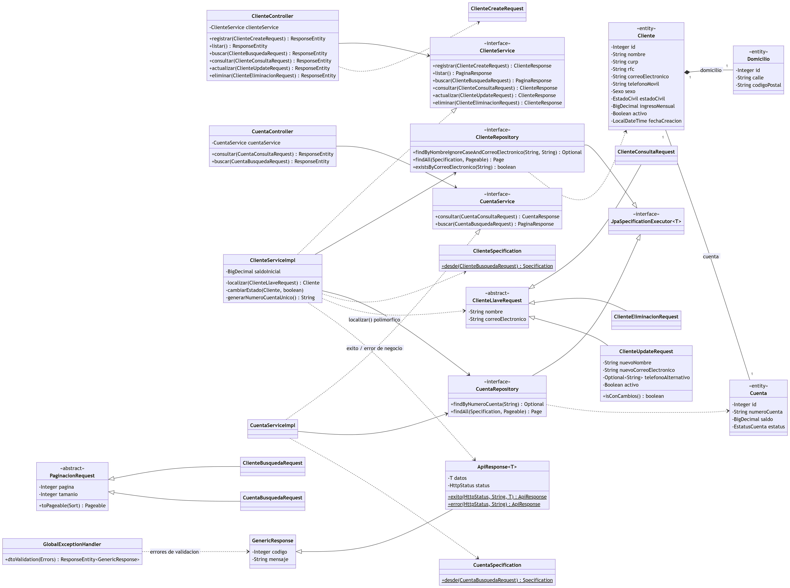

# API REST — Onboarding de Clientes Personas Físicas

## 1. Descripción del proyecto

API REST para registrar clientes personas físicas, validar su información, abrirles automáticamente una cuenta bancaria con saldo inicial y administrarlos: consulta, actualización parcial, baja lógica y búsquedas dinámicas.

Reglas de diseño que sigue la API (según el instrumento de evaluación):

- No se usa `@PathVariable` ni `@RequestParam`: todos los datos llegan en el cuerpo como Request DTOs validados con `@Valid`.
- Los clientes se localizan con la **llave compuesta nombre + correo electrónico**. No hay consulta por ID; el ID sigue siendo la llave primaria en la base de datos.
- Las búsquedas usan **un solo endpoint dinámico** construido con `Specification` de Spring Data JPA, paginado y resuelto en la base de datos (no en memoria).
- Las excepciones se manejan en un solo lugar: `GlobalExceptionHandler` (`@RestControllerAdvice`) con un único método `@ExceptionHandler` que atiende validaciones, JSON mal formado, errores de Spring MVC y errores inesperados, siempre con el formato `{codigo, mensaje}` y sin exponer detalles internos. Los errores de negocio (no encontrado, duplicado, etc.) no usan excepciones: el servicio responde con `codigo: 1`, el mensaje y el código HTTP correspondiente.
- Los controladores nunca reciben ni devuelven entidades JPA.

## 2. Tecnologías utilizadas

| Tecnología | Versión |
|---|---|
| Java | 17 (compila y corre también con 21) |
| Spring Boot | 3.3.6 (Web, Data JPA, Validation, Security, OAuth2 Resource Server) |
| Autenticación | JWT HS256 (Nimbus), BCrypt y A2F TOTP (RFC 6238) |
| Hibernate | 6.5 |
| PostgreSQL | 16 (requisito mínimo: 14) |
| Flyway | migraciones versionadas del esquema |
| springdoc-openapi | 2.6.0 (Swagger UI) |
| Lombok | 1.18 |
| JUnit 5 + Mockito + MockMvc | pruebas |
| Gradle | wrapper incluido (`gradlew`) |

## 3. Configuración de PostgreSQL

1. Crear la base de datos (una sola vez):
   ```sql
   CREATE DATABASE practica1_db;
   ```
2. Configurar las credenciales con variables de entorno (ninguna contraseña real se guarda en `application.properties`):

   | Variable | Por defecto | Uso |
   |---|---|---|
   | `DB_URL` | `jdbc:postgresql://localhost:5432/practica1_db` | Conexión a PostgreSQL |
   | `DB_USERNAME` | `postgres` | Usuario de la base |
   | `DB_PASSWORD` | `postgres` | Contraseña de la base |
   | `GESTOPAGO_PASSWORD` | la de prueba de la documentación de PuntoRed | Contraseña de GestoPago/PuntoRed para obtener el token que usa `GET /productosList` |
   | `GESTOPAGO_ID_DISTRIBUIDOR` | `83` | Distribuidor de GestoPago |
   | `GESTOPAGO_CODIGO_DISPOSITIVO` | `GPS83-TPV-17` | Dispositivo de GestoPago |
   | `SALDO_INICIAL_CUENTA` | `0.00` | Saldo con el que el sistema abre cada cuenta nueva (en Railway: `1000.00`, para pruebas) |
   | `DEPOSITO_MONTO_MAXIMO` | `50000.00` | Monto máximo por cada depósito a la cuenta propia |

   Los valores por defecto bastan para correr en local. Para usar otros, en PowerShell: `$env:DB_PASSWORD = "..."` antes de `.\gradlew.bat bootRun`.
3. **Las tablas no se crean a mano.** Al arrancar, Flyway ejecuta los scripts de `src/main/resources/db/migration`:

   | Script | Contenido |
   |---|---|
   | `V2__create_clientes_onboarding_tables.sql` | Tablas `domicilios`, `clientes` y `cuentas` con PK, FK, UNIQUE e índices |
   | `V3__add_nombre_usuario_to_clientes.sql` | Columna `nombre_usuario` |
   | `V4__reglas_e_indices_onboarding.sql` | Restricciones `CHECK`, relaciones 1:1, índices parciales y limpieza de índices duplicados |
   | `V5__numero_cuenta_16_digitos.sql` | Número de cuenta de 16 dígitos (las cuentas existentes se completan con ceros a la izquierda) |
   | `V6__inicio_sesion_y_a2f.sql` | Contraseña cifrada, segundo factor TOTP e intentos fallidos / bloqueo |
   | `V7__transacciones_gestopago.sql` | Tabla `transacciones`: pagos y recargas enviados a GestoPago con su petición y respuesta |
   | `V8__depositos.sql` | Tabla `depositos`: bitácora de abonos a la cuenta propia con el saldo resultante |

   (`V1` corresponde al módulo de productos/GestoPago).

### Diagrama entidad-relación


Decisiones sobre los datos:

- Los montos son `NUMERIC` (nunca `FLOAT`), para evitar errores de redondeo.
- Los `VARCHAR` tienen la longitud exacta del dato, reforzada con `CHECK`.
- El correo es `UNIQUE` y se guarda en minúsculas; las validaciones de la aplicación no sustituyen a las restricciones de la base de datos.
- Se eliminaron los índices que duplicaban a los `UNIQUE`, y los índices parciales (`WHERE activo`, `WHERE estatus = 'ACTIVA'`) solo indexan los registros activos.

## 4. Instrucciones de ejecución

Con PostgreSQL encendido, desde la carpeta del proyecto:

```bash
.\gradlew.bat bootRun
```

En Linux/macOS: `./gradlew bootRun`. La API queda en `http://localhost:8081`.

- **Swagger UI:** http://localhost:8081/swagger-ui/index.html
- **OpenAPI (JSON):** http://localhost:8081/v3/api-docs

Para ejecutar las pruebas:

```bash
.\gradlew.bat test
```

## 5. Endpoints implementados

Base: `http://localhost:8081/api/v1`

La columna **Token** indica si el endpoint exige `Authorization: Bearer <tokenAcceso>`. Sin token (o con uno inválido o vencido) responde **401** con `codigo: 1`.

| Operación | Método | Endpoint | Body | Token | Éxito | Errores |
|---|---|---|---|---|---|---|
| Crear cliente | POST | `/clientes` | `ClienteCreateRequest` | No | 201 | 400, 409 |
| Iniciar sesión (paso 1) | POST | `/auth/login` | `LoginRequest` | No | 200 | 400, 401, 403, 423 |
| Configurar A2F (primera vez) | POST | `/auth/a2f/configuracion` | `A2fConfiguracionRequest` | No | 200 | 400, 401, 403, 409, 423 |
| Verificar A2F (paso 2) | POST | `/auth/a2f/verificacion` | `A2fVerificacionRequest` | No | 200 | 400, 401, 403, 409, 423 |
| Listar clientes | GET | `/clientes` | — | Sí | 200 | 401 |
| Búsqueda dinámica | POST | `/clientes/busqueda` | `ClienteBusquedaRequest` | Sí | 200 | 400, 401 |
| Consultar por llave compuesta | POST | `/clientes/consulta` | `ClienteConsultaRequest` | Sí | 200 | 400, 401, 404 |
| Actualizar (parcial) | PATCH | `/clientes/actualizacion` | `ClienteUpdateRequest` | Sí | 200 | 400, 401, 404, 409 |
| Eliminar (baja lógica) | DELETE | `/clientes/eliminacion` | `ClienteEliminacionRequest` | Sí | 200 | 400, 401, 404, 409 |
| Consultar cuenta y saldo | POST | `/cuentas/consulta` | `CuentaConsultaRequest` | Sí | 200 | 400, 401, 404 |
| Búsqueda de cuentas | POST | `/cuentas/busqueda` | `CuentaBusquedaRequest` | Sí | 200 | 400, 401 |
| Depositar a mi cuenta | POST | `/cuentas/deposito` | `DepositoRequest` | Sí | 200 | 400, 401, 403, 404, 409, 423 |
| Pago o recarga (GestoPago) | POST | `/transaccion` | `TransaccionRequest` | Sí | 200, 202 | 400, 401, 403, 404, 409, 422, 423, 503 |

Fuera de `/api/v1`: `GET /productosList` (catálogo de PuntoRed) es público, y los endpoints anteriores de personas (`/personas`, `/personasActualiza`, `/personasElimina`) exigen token.

### Inicio de sesión con segundo factor (A2F)

El inicio de sesión tiene dos pasos y entrega dos tokens distintos que **no son intercambiables**:

1. **`POST /auth/login`** con `usuario` (nombre de usuario **o** correo) y `contrasena`. Si son correctos, devuelve un `tokenTemporal` (5 minutos) y `siguientePaso`:
   - `CONFIGURAR_A2F`: el cliente todavía no tiene segundo factor.
   - `VERIFICAR_A2F`: ya lo tiene; solo falta el código.
2. **Solo la primera vez:** `POST /auth/a2f/configuracion` con el `tokenTemporal`. Devuelve el `secreto` y la `uriOtpauth`: se escanea como QR (o se captura el secreto a mano) en Google Authenticator, Microsoft Authenticator o cualquier app TOTP.
3. **`POST /auth/a2f/verificacion`** con el `tokenTemporal` y el `codigo` de 6 dígitos de la app. La primera vez también activa el A2F. Devuelve el `tokenAcceso` (30 minutos), el `nombreUsuario` y el `numeroCuenta`.

Reglas de seguridad:

- La contraseña se guarda cifrada con **BCrypt**; nunca se devuelve ni se registra en el log.
- Un usuario inexistente y una contraseña incorrecta responden el mismo mensaje y tardan lo mismo, para no revelar qué usuarios existen.
- **5 intentos fallidos** seguidos (de contraseña o de código) bloquean el inicio de sesión **15 minutos** (423). Se configura con `seguridad.login.*`.
- Un código TOTP no se acepta dos veces, y se tolera un paso de 30 s de desfase en el reloj del teléfono.
- El token temporal no abre ningún endpoint protegido, y el token de acceso no sirve para el paso A2F.
- Los clientes registrados antes de la migración `V6` no tienen contraseña y no pueden iniciar sesión hasta que se les asigne una.
- Por ahora el único método es TOTP. Huella y reconocimiento facial se agregarían como nuevos valores de `MetodoA2F` usando WebAuthn (passkeys).

### Saldo de la cuenta: saldo inicial y depósitos

El cliente **no** decide con cuánto abre su cuenta: el alta es pública y, si pudiera mandar su saldo, cualquiera crearía cuentas con dinero inventado. El dinero entra de dos formas:

1. **Saldo inicial:** lo define el sistema con `SALDO_INICIAL_CUENTA` (por defecto `0.00`). En el despliegue de Railway vale `1000.00` para que se puedan probar pagos sin pasos extra.
2. **Depósito** (`POST /cuentas/deposito`): el titular abona a **su propia** cuenta con token de acceso y código 2FA.
   ```json
   { "numeroCuenta": "4152313748382907", "monto": 500.00, "codigoA2F": "123456" }
   ```
   - La cuenta debe ser del usuario de la sesión (403 si no) y estar activa.
   - El monto debe ser mayor a cero y no rebasar `DEPOSITO_MONTO_MAXIMO` (50,000 por defecto).
   - El código 2FA sigue las mismas reglas que en los pagos (`ValidadorA2F`): un código, una operación; protegido contra doble clic y contado para el bloqueo por intentos.
   - Se abona con la cuenta bloqueada (`SELECT ... FOR UPDATE`) y se registra en la tabla `depositos` con el saldo resultante, así un depósito y un pago simultáneos nunca leen el mismo saldo.

### Pagos y recargas con GestoPago (`POST /transaccion`)

Basado en la documentación de PuntoRed (*Key Points*, *Encryption Snipplets*, `sendTx` y `confirmTx`). Lo ejecuta `SendTxHandler` (paquete `handler`), que el controlador manda llamar con el cliente de la sesión:

```java
SendTxComando comando = new SendTxComando(Integer.valueOf(sesion.getSubject()), request);
ApiResponse<TransaccionResponse> respuesta = sendTxHandler.handle(comando);
return ResponseEntity.status(respuesta.getStatus()).body(respuesta);
```

Cuerpo (también acepta los nombres del diagrama `idSer`, `idProd` y `2fa`):

```json
{ "numeroCuenta": "4152313748382907", "idServicio": 133, "idProducto": 582,
  "monto": 10.00, "telefono": "5555555551", "codigoA2F": "123456" }
```

Flujo:

1. **Validaciones previas:** la cuenta existe y **es del usuario de la sesión** (403 si no), cliente y cuenta activos, **saldo** suficiente, el producto está en el catálogo (`/productosList`) y cumple sus reglas, y el **código 2FA** es válido. Un código incorrecto cuenta para el mismo bloqueo de 5 intentos que el inicio de sesión, y un código no autoriza dos pagos: se marca como usado con un `UPDATE` condicional en la base de datos **antes** de apartar el saldo, así que si llegan dos peticiones iguales al mismo tiempo (doble clic o reintento automático) solo una pasa y la otra responde 409 sin cobrar.
2. **Payload SendTx**, con los nombres, el orden y las longitudes de la documentación: `idProducto`, `idServicio`, `telefono` (10–20), `horaLocal` (`yyyyMMddHHmmss`, hora de Ciudad de México), `referencia` (1–100) y `montoPago` solo en pago de servicios, `upc` (cadena aleatoria de 10 caracteres alfanuméricos, única) y `unidad` (3–25).
   - **tipoFront 1** (recargas): el teléfono va en `telefono` y el monto debe ser igual al precio del producto.
   - **tipoFront 2** (servicios): `telefono` fijo `1111111111`, y `referencia` y `montoPago` obligatorios.
   - **idCatTipoServicio 10 y 11** (canjeables): `telefono` fijo `#1111111111`.
   - Otros tipoFront (cash-in, transferencias) responden 422.
3. **Saldo apartado:** con la cuenta bloqueada (`SELECT ... FOR UPDATE`) se vuelve a validar y se descuenta el monto, y se registra la transacción `PENDIENTE`. Así dos pagos simultáneos no pueden dejar el saldo en negativo.
4. **Cifrado** (`AesEncryption`, el snippet de Java de la documentación, usado por `CifradoGestoPago`): AES/CBC/PKCS5Padding, llave e IV en Base64 y resultado en Base64. Una prueba verifica que se obtiene exactamente el *Encryption Expected Result* de la documentación.
5. **Token** (`GestoPagoTokenService`): se reutiliza el token guardado y solo se pide uno nuevo cada 23 h, porque PuntoRed permite uno al día y prohíbe pedirlo en cada petición. Si GestoPago responde 401/403, se renueva y se reintenta una vez.
6. **Envío** (`GestoPagoTxGateway`): `POST /sistema/service/sendTx.do` como formulario urlencoded con `random` (timestamp) y `signed` (payload cifrado), con `Authorization: Bearer <token>` y `X-API-Key` si se configuró. El timeout de lectura es de 70 s, mayor a los 62 s que espera GestoPago.
7. **Respuesta** (XML, sin cifrar):

   | GestoPago | Estatus | HTTP | Saldo |
   |---|---|---|---|
   | Código `01` | `APLICADA` | 200 *Pago exitoso.* | Queda descontado |
   | Código `02` (saldo del distribuidor con PuntoRed) | `RECHAZADA` | 503 con mensaje propio | Se devuelve |
   | Código `06` (duplicada en GestoPago) | `RECHAZADA` | 409 con mensaje propio | Se devuelve |
   | Otro código | `RECHAZADA` | 422 con mensaje propio | Se devuelve |

   Como pide la documentación (*"the failure cases must be mapped to the error codes on your application side"*), `RechazoGestoPago` traduce cada código a un mensaje propio que incluye la referencia `GP-xx`. El texto original de GestoPago solo se guarda en la bitácora.
   | Código `82` o sin respuesta | `PENDIENTE_CONFIRMACION` | 202 | Sigue apartado |
   | No se pudo enviar (sin token) | `RECHAZADA` | 503 | Se devuelve |

**confirmTx:** `ConfirmTxProceso` revisa cada minuto las transacciones sin respuesta de entre 62 s y 24 h y las confirma con los mismos parámetros. El código `06` las marca como aplicadas; el `70` las rechaza y devuelve el saldo. Las de más de 24 h se quedan para revisión manual.

**Bitácora:** la tabla `transacciones` guarda el JSON enviado, la respuesta tal como llegó, el UPC, el número de autorización y el PIN, como exige la documentación.

**Configuración:**

- **Llave e IV de cifrado:** no están en el código ni en `application.properties`. Se toman de las variables de entorno `GESTOPAGO_SECRET_KEY` y `GESTOPAGO_IV`, o del archivo `config/gestopago.properties`, que está fuera de Git; `config/gestopago.properties.example` sirve de plantilla. Sin ellas la API arranca, pero los pagos responden 503 sin hacer ningún cargo.
- **Otros valores:** `GESTOPAGO_API_KEY` (opcional) y `GESTOPAGO_UNIDAD` (por defecto `083`).

### Reglas por operación

- **Crear:** valida todos los campos con Bean Validation. El cliente debe ser mayor de edad, y CURP, RFC, correo y usuario deben ser únicos (se verifica en el servicio y en la base de datos). La `contrasena` debe tener de 8 a 64 caracteres sin espacios, con al menos una mayúscula, una minúscula, un número y un carácter especial. El sistema abre una cuenta **ACTIVA** con número único de **16 dígitos** y el saldo inicial que define la propiedad `onboarding.cuenta.saldo-inicial`, que no puede ser negativa. Si el cliente envía `id`, `fechaCreacion`, `saldo` o `activo`, esos valores se ignoran.
- **Listar:** devuelve la primera página (20 registros). Para otras páginas o filtros se usa `/busqueda`.
- **Búsqueda:** todos los criterios son opcionales y se combinan con AND; los que no se envían se excluyen.
  - `nombre`: coincidencia **parcial** sin distinguir mayúsculas, en nombres y apellidos.
  - `correoElectronico`, `telefono` (móvil o alternativo), `activo`, `curp`, `rfc` y `numeroCuenta`: coincidencia **exacta**.
  - `fechaRegistroDesde` / `fechaRegistroHasta`: rango inclusivo.
  - `pagina` empieza en 0; `tamanio` va de 1 a 100.
- **Consultar:** `nombre` (sin distinguir mayúsculas) y `correoElectronico` deben coincidir con el mismo cliente. Si no, responde 404 con `codigo: 1`.
- **Actualizar (PATCH):**
  - `nombre` y `correoElectronico` son la llave con los valores **actuales**; para cambiarlos se usan `nuevoNombre` y `nuevoCorreoElectronico` (este último debe ser único).
  - Solo se modifican los campos enviados.
  - En los campos **obligatorios**, un valor omitido o `null` no cambia nada, así que nunca se sobrescriben con null por accidente.
  - En los campos **opcionales** (`segundoNombre`, `telefonoAlternativo`, `domicilio.numeroInterior`) se distinguen los dos casos: omitido = sin cambio; `null` explícito = se borra el valor. Para eso esos campos son `Optional` en el DTO.
  - `curp`, `rfc` y `numeroCuenta` no son modificables: si se envían, responde 400.
  - Si no se envía ningún cambio, responde 400.
  - Un cliente dado de baja solo se puede reactivar (`"activo": true`); la reactivación también activa su cuenta.
- **Eliminar:** es una **baja lógica**. Pone `activo = false` en el cliente y `INACTIVA` en su cuenta, porque solo los clientes activos pueden tener cuentas activas. No se borra ningún registro. Dar de baja de nuevo al mismo cliente responde 409.

## 6. Ejemplos de peticiones y respuestas

### Crear cliente — `POST /api/v1/clientes`

```json
{
  "nombre": "Juan", "segundoNombre": "Carlos",
  "apellidoPaterno": "Pérez", "apellidoMaterno": "López",
  "fechaNacimiento": "1995-05-20",
  "curp": "PELJ950520HDFRRN01", "rfc": "PELJ950520AB1",
  "sexo": "M", "nacionalidad": "Mexicana", "estadoCivil": "SOLTERO",
  "correoElectronico": "juan.perez@correo.com", "nombreUsuario": "juanperez95", "contrasena": "Segura#2026",
  "telefonoMovil": "4771234567", "telefonoAlternativo": "4770000000",
  "ocupacion": "Desarrollador", "empresa": "Tech Solutions", "ingresoMensual": 25000.00,
  "domicilio": {
    "calle": "Av. Reforma", "numeroExterior": "222", "numeroInterior": "Piso 5",
    "colonia": "Juárez", "municipio": "Cuauhtémoc", "estado": "CDMX",
    "codigoPostal": "06600", "pais": "México"
  }
}
```

**201 Created**
```json
{
  "codigo": 0,
  "mensaje": "Cliente registrado correctamente.",
  "datos": {
    "id": 1, "nombre": "Juan", "curp": "PELJ950520HDFRRN01",
    "correoElectronico": "juan.perez@correo.com", "telefonoMovil": "4771234567",
    "numeroCuenta": "4152313748382907", "saldoCuenta": "0.00", "estatusCuenta": "ACTIVA",
    "activo": true, "fechaCreacion": "2026-10-16T18:38:46.91"
  }
}
```

**409 Conflict** (correo repetido)
```json
{ "codigo": 1, "mensaje": "El correo ya se encuentra registrado. Intente con otro correo." }
```

**400 Bad Request** (validación)
```json
{
  "codigo": 1,
  "mensaje": "Datos no validos{nombre=El nombre es obligatorio y no puede contener solo espacios., correoElectronico=El correo electrónico no tiene un formato válido., telefonoMovil=El teléfono debe contener exactamente 10 dígitos.}"
}
```

### Consultar por llave compuesta — `POST /api/v1/clientes/consulta`

```json
{ "nombre": "Juan", "correoElectronico": "juan.perez@correo.com" }
```
**200 OK**: `{ "codigo": 0, "mensaje": "Cliente encontrado.", "datos": { ... } }`

**404 Not Found**
```json
{ "codigo": 1, "mensaje": "No existe un cliente con el nombre y correo electrónico proporcionados." }
```

### Búsqueda dinámica — `POST /api/v1/clientes/busqueda`

```json
{ "nombre": "pér", "activo": true, "pagina": 0, "tamanio": 10 }
```
**200 OK**
```json
{
  "codigo": 0,
  "mensaje": "Se encontraron 2 cliente(s).",
  "datos": { "contenido": [ { "id": 1, "nombre": "Juan" } ], "pagina": 0, "tamanio": 10, "totalElementos": 2, "totalPaginas": 1 }
}
```

### Actualización parcial — `PATCH /api/v1/clientes/actualizacion`

```json
{
  "nombre": "Juan", "correoElectronico": "juan.perez@correo.com",
  "estadoCivil": "CASADO",
  "telefonoAlternativo": null,
  "domicilio": { "codigoPostal": "06700" },
  "nuevoCorreoElectronico": "juan.nuevo@correo.com"
}
```
Este ejemplo cambia el estado civil, el código postal y el correo, y **borra** el teléfono alternativo. Los demás campos se conservan.

### Eliminación lógica — `DELETE /api/v1/clientes/eliminacion`

```json
{ "nombre": "Juan", "correoElectronico": "juan.nuevo@correo.com" }
```
**200 OK**: `{ "codigo": 0, "mensaje": "Cliente eliminado correctamente (baja lógica).", "datos": { "activo": false, "estatusCuenta": "INACTIVA" } }`

### Consultar saldo — `POST /api/v1/cuentas/consulta`

```json
{ "numeroCuenta": "4152313748382907" }
```
**200 OK**: `{ "codigo": 0, "mensaje": "Cuenta encontrada.", "datos": { "numeroCuenta": "4152313748382907", "saldo": "0.00", "estatus": "ACTIVA", ... } }`

### Respuestas de error

Todas las respuestas de la API tienen la forma `{ "codigo", "mensaje", "datos" }` (`GenericResponse` / `ApiResponse`): `codigo` es **0** si la operación tuvo éxito y **1** si hubo un error; `datos` solo aparece en las respuestas exitosas.

| HTTP | Quién la genera | Cuándo |
|---|---|---|
| 400 | `GlobalExceptionHandler.dtoValidation` | Falla alguna validación de Bean Validation (`@Valid`). El mensaje lista cada campo con su error |
| 401 | `SeguridadConfig` (`codigo: 1`) | Endpoint protegido sin token de acceso, o con uno inválido, vencido o temporal |
| 401 | Servicio (`codigo: 1`) | Usuario o contraseña incorrectos, código A2F inválido o token temporal vencido |
| 403 | Servicio (`codigo: 1`) | Inicio de sesión de un cliente dado de baja |
| 404 | Servicio (`codigo: 1`) | No hay cliente con ese nombre y correo, o no existe la cuenta |
| 409 | Servicio (`codigo: 1`) | CURP, RFC, correo o usuario repetido; cliente ya dado de baja; A2F ya configurado o sin configurar |
| 409 | Handler (`codigo: 1`) | Código 2FA en uso por otra petición simultánea, u operación duplicada en GestoPago (código 06) |
| 422 | Handler (`codigo: 1`) | GestoPago rechazó el pago, o el tipo de producto no se puede pagar |
| 423 | Servicio (`codigo: 1`) | Inicio de sesión o pagos bloqueados temporalmente por intentos fallidos |
| 503 | Handler (`codigo: 1`) | No fue posible conectar con GestoPago o su catálogo, o falta saldo del distribuidor (código 02); no se hizo ningún cargo |
| 400 / 404 / 405 / 415 / 500 | `GlobalExceptionHandler` (`codigo: 1`) | JSON mal formado, ruta inexistente, método o tipo de contenido no soportado, error inesperado. El detalle técnico solo va al log del servidor; además `server.error.include-stacktrace=never` cubre los errores que ocurren fuera de los controladores |

## 7. Consumo de los servicios REST

- Todas las peticiones con cuerpo usan el encabezado `Content-Type: application/json` y texto en UTF-8.
- Todas las respuestas tienen la forma `{ "codigo", "mensaje", "datos" }`. El consumidor revisa primero el código HTTP y `codigo` (0 = éxito, 1 = error) y después lee `datos` o muestra `mensaje`.
- La forma más sencilla de probar es **Swagger UI**: muestra cada endpoint con su DTO de ejemplo y el botón *Try it out*. Después de iniciar sesión, pegue el `tokenAcceso` en el botón **Authorize**.
- Con curl, los endpoints protegidos llevan el token de acceso:
  ```bash
  curl -X POST http://localhost:8081/api/v1/clientes/consulta -H "Content-Type: application/json" -H "Authorization: Bearer <tokenAcceso>" -d "{\"nombre\":\"Juan\",\"correoElectronico\":\"juan.perez@correo.com\"}"
  ```
- Con Postman: elegir el método, la URL `http://localhost:8081/api/v1/...` y en *Body* seleccionar *raw → JSON*. En *Authorization* elegir *Bearer Token*. `DELETE /eliminacion` también lleva cuerpo.
- El secreto JWT se toma de la variable de entorno `JWT_SECRETO` (mínimo 32 caracteres). El valor por defecto de `application.properties` es solo para desarrollo local.

## 8. Evidencia de pruebas realizadas

### Pruebas automatizadas (`.\gradlew.bat test`): 151 pruebas, todas aprobadas

| Suite | Pruebas | Qué cubre |
|---|---|---|
| `DepositoHandlerTest` | 8 | Depósito correcto con folio y saldo, cuenta inexistente, ajena o inactiva, monto mayor al máximo, 2FA incorrecto, doble clic, cuenta dada de baja al bloquearla |
| `RegistroDepositosTest` | 2 | Abono con la cuenta bloqueada y saldo resultante en la bitácora; cuenta inactiva no abona |
| `SendTxHandlerTest` | 22 | Cuenta inexistente o ajena, cliente o cuenta inactivos, saldo insuficiente (también entre pagos simultáneos), producto fuera del catálogo, reglas de tipoFront y teléfonos fijos, 2FA incorrecto, sin configurar, reutilizado o en uso por un doble clic, payload exacto, éxito, rechazos 02/06/otros con mensaje propio, código 82, sin respuesta y no enviada |
| `GestoPagoTxIntegracionTest` | 5 | **Integración** con WireMock (Feign + cifrado + gateway reales): POST urlencoded con `random`/`signed`, `Authorization` y `X-API-Key`, payload cifrado en la red, 403 → token renovado, timeout de lectura, código 82, confirmTx con el mismo `signed` |
| `GlobalExceptionHandlerTest` | 4 | JSON mal formado, `ResponseStatusException`, 405 y error inesperado sin exponer detalles internos |
| `GestoPagoTxGatewayTest` | 7 | Formulario `random` + `signed` y token Bearer, reintento con token renovado tras 403, timeout, sin token, XML ilegible, `ID_TX` de confirmTx |
| `CifradoGestoPagoTest` | 6 | Vector oficial de la documentación con el snippet `AesEncryption` y con `CifradoGestoPago`, UTF-8, sin llaves configuradas, longitudes de llave e IV |
| `RegistroTransaccionesTest` | 6 | Saldo apartado, saldo insuficiente, bitácora de la respuesta, devolución una sola vez, nunca revertir una aplicada |
| `ConfirmTxProcesoTest` | 4 | Códigos 06 y 70, reintento sin resultado, transacciones en curso o interrumpidas |
| `AuthServiceImplTest` | 16 | Login con usuario o correo, mismo mensaje para usuario inexistente y contraseña incorrecta, cliente sin contraseña o dado de baja, bloqueo por intentos y su vencimiento, configuración y activación del A2F, código reutilizado o incorrecto, token temporal inválido |
| `SeguridadConfigTest` | 8 | Cadena de seguridad real: 401 sin token, token de acceso válido, token temporal y token alterado rechazados, login y alta públicos, el pago exige token y toma al cliente del token |
| `TotpTest` | 7 | Vectores oficiales del RFC 6238, desfase de un paso, código viejo, no reutilización, formato inválido, secreto y URI `otpauth://` |
| `TokenJwtTest` | 5 | Separación de tokens temporal y de acceso, firma ajena, token mal formado, secreto mínimo de 32 bytes |
| `ProductoServiceImplTest` | 7 | Lista de productos de PuntoRed: éxito, sin token, token expirado, timeout, servicio no disponible, código de error |
| `ClienteServiceImplTest` | 22 | Alta con cuenta ACTIVA de 16 dígitos y contraseña cifrada con BCrypt, reintento del número de cuenta, saldo inicial inválido, CURP/RFC/correo/usuario duplicados (codigo 1 + 409), cliente inexistente (codigo 1 + 404), consulta por llave compuesta, búsqueda paginada, actualización parcial, `null` explícito vs omitido, cambio de correo, correo duplicado, cliente inactivo, reactivación, baja lógica |
| `CuentaServiceImplTest` | 3 | Saldo, cuenta inexistente, cuentas activas |
| `ClienteControllerTest` | 17 | Códigos HTTP, mensajes de validación por campo (incluida la mayoría de edad), campos del servidor ignorados, enum inválido, paginación máxima, rango de fechas, PATCH con `null` vs omitido, PATCH sin cambios, CURP/RFC/cuenta no modificables, errores de negocio con codigo 1 |

El reporte HTML queda en `build/reports/tests/test/index.html`.

### Pruebas manuales contra PostgreSQL 16

Se ejecutaron sobre la API real, antes de agregar el inicio de sesión, y todas respondieron lo esperado (el inicio de sesión y el A2F solo están cubiertos por las pruebas automatizadas):

- **Crear:** 201 con `codigo: 0`; al repetir la CURP, 409 con `codigo: 1`.
- **Listar:** GET con la página 1.
- **Búsqueda:** por nombre parcial con acentos, por teléfono alternativo y con paginación (`totalPaginas = 2` con `tamanio = 1`); `tamanio = 500` responde 400.
- **Consultar:** 200 sin distinguir mayúsculas en el nombre; con un nombre que no coincide, 404.
- **Actualizar:** PATCH que borra el teléfono alternativo y el número interior y conserva un `apellidoPaterno` enviado como null. Un correo de otro cliente responde 409 con `codigo: 1`; un cambio de correo válido responde 200.
- **Eliminar:** baja lógica (200), repetir la baja (409), PATCH sobre un cliente dado de baja (409), reactivación con `activo: true` (la cuenta vuelve a ACTIVA).
- **Cuentas:** consulta por número (200 / 404) y búsqueda de cuentas INACTIVAS.
- **Validación:** un alta con varios campos inválidos responde 400 con `codigo: 1` y el mensaje de cada campo.
- **Errores por defecto de Spring:** JSON mal formado (400), PUT no soportado (405) y un tipo de dato incorrecto (400) responden sin traza ni detalles internos.

## 9. Diagrama de clases

Imagen: [`docs/diagrama-clases.png`](docs/diagrama-clases.png) (también en [SVG](docs/diagrama-clases.svg); la fuente Mermaid está en [`docs/diagrama-clases.mmd`](docs/diagrama-clases.mmd)).



Conceptos de POO que muestra el diagrama:

| Concepto | Dónde |
|---|---|
| **Interfaces** | `ClienteService` y `CuentaService` (los controladores dependen de la interfaz, no de la implementación); `ClienteRepository` y `CuentaRepository`, que extienden `JpaRepository` y `JpaSpecificationExecutor` |
| **Clases abstractas** | `ClienteLlaveRequest` (llave nombre + correo) y `PaginacionRequest` (página y tamaño) |
| **Herencia** | `ClienteConsultaRequest`, `ClienteEliminacionRequest` y `ClienteUpdateRequest` heredan la llave compuesta; `ClienteBusquedaRequest` y `CuentaBusquedaRequest` heredan la paginación; `ApiResponse<T>` hereda `codigo` y `mensaje` de `GenericResponse` |
| **Polimorfismo** | `ClienteServiceImpl.localizar(ClienteLlaveRequest)` recibe cualquier subtipo (consulta, actualización o eliminación) y los trata igual; `ApiResponse` se usa donde se espera un `GenericResponse`, y los controladores dependen de las interfaces `ClienteService` / `CuentaService`, no de sus implementaciones |
| **Relaciones entre entidades** | `Cliente` 1:1 `Domicilio` (composición) y `Cliente` 1:1 `Cuenta` |

### Estructura de paquetes

```
com.proyecto.servicios
├── controller        ClienteController, CuentaController, AuthController, TransaccionController
├── handler           Handler<I, O>, SendTxHandler (pago con GestoPago), DepositoHandler (depósito),
│                     ConfirmTxProceso (confirmTx),
│                     RechazoGestoPago (códigos de GestoPago → mensajes propios)
├── service           ClienteService, CuentaService, AuthService (interfaces)
│   └── impl          ClienteServiceImpl, CuentaServiceImpl, AuthServiceImpl, RegistroTransacciones,
│                     RegistroDepositos
├── seguridad         TokenJwt (JWT HS256 temporal y de acceso), Totp (RFC 6238), IntentosFallidos,
│                     ValidadorA2F (código 2FA de pagos y depósitos),
│                     CifradoGestoPago (AES-256-CBC)
├── client            Feign de GestoPago (auth, productos, sendTx/confirmTx) y GestoPagoTxGateway
├── repository.sf     ClienteRepository, CuentaRepository, DomicilioRepository, TransaccionRepository,
│                     DepositoRepository
├── specification     ClienteSpecification, CuentaSpecification
├── entity.sf         Cliente, Domicilio, Cuenta, Transaccion, Deposito
├── enums             Catalogos (Sexo, EstadoCivil, EstatusCuenta, MetodoA2F, PasoLogin)
├── dto
│   ├── request       ClienteCreateRequest, ClienteUpdateRequest, ClienteBusquedaRequest,
│   │                 ClienteConsultaRequest, ClienteEliminacionRequest, ClienteLlaveRequest,
│   │                 PaginacionRequest, DomicilioRequest, DomicilioUpdateRequest,
│   │                 CuentaConsultaRequest, CuentaBusquedaRequest, LoginRequest,
│   │                 A2fTokenRequest, A2fConfiguracionRequest, A2fVerificacionRequest,
│   │                 TransaccionRequest, DepositoRequest
│   └── response      GenericResponse, ApiResponse, PaginaResponse, ClienteResponse,
│                     DomicilioResponse, CuentaResponse, LoginResponse,
│                     A2fConfiguracionResponse, TokenResponse, TransaccionResponse,
│                     DepositoResponse
├── exception         GlobalExceptionHandler (manejo centralizado de excepciones)
├── validation        @MayorDeEdad y su validador, expresiones regulares compartidas
├── mapper            ClienteMapper (DTO <-> entidad)
└── config            Base de datos, Flyway, OpenAPI, Feign, seguridad (SeguridadConfig)
```
