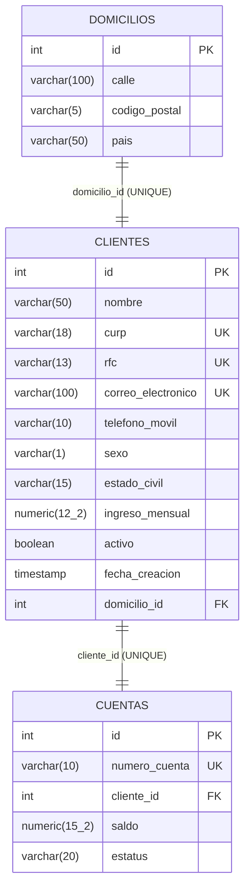

# API REST — Onboarding de Clientes Personas Físicas

## 1. Descripción del proyecto

API REST para registrar clientes personas físicas, validar su información, abrirles automáticamente una cuenta bancaria con saldo inicial y administrarlos: consulta, actualización parcial, baja lógica y búsquedas dinámicas.

Reglas de diseño que sigue la API (según el instrumento de evaluación):

- No se usa `@PathVariable` ni `@RequestParam`: todos los datos llegan en el cuerpo como Request DTOs validados con `@Valid`.
- Los clientes se localizan con la **llave compuesta nombre + correo electrónico**. No hay consulta por ID; el ID sigue siendo la llave primaria en la base de datos.
- Las búsquedas usan **un solo endpoint dinámico** construido con `Specification` de Spring Data JPA, paginado y resuelto en la base de datos (no en memoria).
- Los errores de validación se manejan en un solo lugar: `GlobalExceptionHandler` (`@RestControllerAdvice`) con un único método `@ExceptionHandler`. Los errores de negocio (no encontrado, duplicado, etc.) no usan excepciones: el servicio responde con `codigo: 1`, el mensaje y el código HTTP correspondiente.
- Los controladores nunca reciben ni devuelven entidades JPA.

## 2. Tecnologías utilizadas

| Tecnología | Versión |
|---|---|
| Java | 17 (compila y corre también con 21) |
| Spring Boot | 3.3.6 (Web, Data JPA, Validation) |
| Hibernate | 6.5 |
| PostgreSQL | 16 (requisito mínimo: 14) |
| Flyway | migraciones versionadas del esquema |
| springdoc-openapi | 2.6.0 (Swagger UI) |
| Lombok | 1.18 |
| JUnit 5 + Mockito + MockMvc | pruebas |
| Gradle | wrapper incluido (`gradlew`) |

## 3. Configuración de PostgreSQL

1. Crear la base de datos (una sola vez):
   ```sql
   CREATE DATABASE practica1_db;
   ```
2. Configurar las credenciales con variables de entorno (ninguna contraseña real se guarda en `application.properties`):

   | Variable | Por defecto | Uso |
   |---|---|---|
   | `DB_URL` | `jdbc:postgresql://localhost:5432/practica1_db` | Conexión a PostgreSQL |
   | `DB_USERNAME` | `postgres` | Usuario de la base |
   | `DB_PASSWORD` | `postgres` | Contraseña de la base |
   | `GESTOPAGO_PASSWORD` | la de prueba de la documentación de PuntoRed | Contraseña de GestoPago/PuntoRed para obtener el token que usa `GET /productosList` |
   | `GESTOPAGO_ID_DISTRIBUIDOR` | `83` | Distribuidor de GestoPago |
   | `GESTOPAGO_CODIGO_DISPOSITIVO` | `GPS83-TPV-17` | Dispositivo de GestoPago |

   Los valores por defecto bastan para correr en local. Para usar otros, en PowerShell: `$env:DB_PASSWORD = "..."` antes de `.\gradlew.bat bootRun`.
3. **Las tablas no se crean a mano.** Al arrancar, Flyway ejecuta los scripts de `src/main/resources/db/migration`:

   | Script | Contenido |
   |---|---|
   | `V2__create_clientes_onboarding_tables.sql` | Tablas `domicilios`, `clientes` y `cuentas` con PK, FK, UNIQUE e índices |
   | `V3__add_nombre_usuario_to_clientes.sql` | Columna `nombre_usuario` |
   | `V4__reglas_e_indices_onboarding.sql` | Restricciones `CHECK`, relaciones 1:1, índices parciales y limpieza de índices duplicados |

   (`V1` corresponde al módulo de productos/GestoPago).

### Diagrama entidad-relación



Decisiones sobre los datos:

- Los montos son `NUMERIC` (nunca `FLOAT`), para evitar errores de redondeo.
- Los `VARCHAR` tienen la longitud exacta del dato, reforzada con `CHECK`.
- El correo es `UNIQUE` y se guarda en minúsculas; las validaciones de la aplicación no sustituyen a las restricciones de la base de datos.
- Se eliminaron los índices que duplicaban a los `UNIQUE`, y los índices parciales (`WHERE activo`, `WHERE estatus = 'ACTIVA'`) solo indexan los registros activos.

## 4. Instrucciones de ejecución

Con PostgreSQL encendido, desde la carpeta del proyecto:

```bash
.\gradlew.bat bootRun
```

En Linux/macOS: `./gradlew bootRun`. La API queda en `http://localhost:8081`.

- **Swagger UI:** http://localhost:8081/swagger-ui/index.html
- **OpenAPI (JSON):** http://localhost:8081/v3/api-docs

Para ejecutar las pruebas:

```bash
.\gradlew.bat test
```

## 5. Endpoints implementados

Base: `http://localhost:8081/api/v1`

| Operación | Método | Endpoint | Body | Éxito | Errores |
|---|---|---|---|---|---|
| Crear cliente | POST | `/clientes` | `ClienteCreateRequest` | 201 | 400, 409 |
| Listar clientes | GET | `/clientes` | — | 200 | — |
| Búsqueda dinámica | POST | `/clientes/busqueda` | `ClienteBusquedaRequest` | 200 | 400 |
| Consultar por llave compuesta | POST | `/clientes/consulta` | `ClienteConsultaRequest` | 200 | 400, 404 |
| Actualizar (parcial) | PATCH | `/clientes/actualizacion` | `ClienteUpdateRequest` | 200 | 400, 404, 409 |
| Eliminar (baja lógica) | DELETE | `/clientes/eliminacion` | `ClienteEliminacionRequest` | 200 | 400, 404, 409 |
| Consultar cuenta y saldo | POST | `/cuentas/consulta` | `CuentaConsultaRequest` | 200 | 400, 404 |
| Búsqueda de cuentas | POST | `/cuentas/busqueda` | `CuentaBusquedaRequest` | 200 | 400 |

### Reglas por operación

- **Crear:** valida todos los campos con Bean Validation. El cliente debe ser mayor de edad, y CURP, RFC, correo y usuario deben ser únicos (se verifica en el servicio y en la base de datos). El sistema abre una cuenta **ACTIVA** con número único de 10 dígitos y el saldo inicial que define la propiedad `onboarding.cuenta.saldo-inicial`, que no puede ser negativa. Si el cliente envía `id`, `fechaCreacion`, `saldo` o `activo`, esos valores se ignoran.
- **Listar:** devuelve la primera página (20 registros). Para otras páginas o filtros se usa `/busqueda`.
- **Búsqueda:** todos los criterios son opcionales y se combinan con AND; los que no se envían se excluyen.
  - `nombre`: coincidencia **parcial** sin distinguir mayúsculas, en nombres y apellidos.
  - `correoElectronico`, `telefono` (móvil o alternativo), `activo`, `curp`, `rfc` y `numeroCuenta`: coincidencia **exacta**.
  - `fechaRegistroDesde` / `fechaRegistroHasta`: rango inclusivo.
  - `pagina` empieza en 0; `tamanio` va de 1 a 100.
- **Consultar:** `nombre` (sin distinguir mayúsculas) y `correoElectronico` deben coincidir con el mismo cliente. Si no, responde 404 con `codigo: 1`.
- **Actualizar (PATCH):**
  - `nombre` y `correoElectronico` son la llave con los valores **actuales**; para cambiarlos se usan `nuevoNombre` y `nuevoCorreoElectronico` (este último debe ser único).
  - Solo se modifican los campos enviados.
  - En los campos **obligatorios**, un valor omitido o `null` no cambia nada, así que nunca se sobrescriben con null por accidente.
  - En los campos **opcionales** (`segundoNombre`, `telefonoAlternativo`, `domicilio.numeroInterior`) se distinguen los dos casos: omitido = sin cambio; `null` explícito = se borra el valor. Para eso esos campos son `Optional` en el DTO.
  - `curp`, `rfc` y `numeroCuenta` no son modificables: si se envían, responde 400.
  - Si no se envía ningún cambio, responde 400.
  - Un cliente dado de baja solo se puede reactivar (`"activo": true`); la reactivación también activa su cuenta.
- **Eliminar:** es una **baja lógica**. Pone `activo = false` en el cliente y `INACTIVA` en su cuenta, porque solo los clientes activos pueden tener cuentas activas. No se borra ningún registro. Dar de baja de nuevo al mismo cliente responde 409.

## 6. Ejemplos de peticiones y respuestas

### Crear cliente — `POST /api/v1/clientes`

```json
{
  "nombre": "Juan", "segundoNombre": "Carlos",
  "apellidoPaterno": "Pérez", "apellidoMaterno": "López",
  "fechaNacimiento": "1995-05-20",
  "curp": "PELJ950520HDFRRN01", "rfc": "PELJ950520AB1",
  "sexo": "M", "nacionalidad": "Mexicana", "estadoCivil": "SOLTERO",
  "correoElectronico": "juan.perez@correo.com", "nombreUsuario": "juanperez95",
  "telefonoMovil": "4771234567", "telefonoAlternativo": "4770000000",
  "ocupacion": "Desarrollador", "empresa": "Tech Solutions", "ingresoMensual": 25000.00,
  "domicilio": {
    "calle": "Av. Reforma", "numeroExterior": "222", "numeroInterior": "Piso 5",
    "colonia": "Juárez", "municipio": "Cuauhtémoc", "estado": "CDMX",
    "codigoPostal": "06600", "pais": "México"
  }
}
```

**201 Created**
```json
{
  "codigo": 0,
  "mensaje": "Cliente registrado correctamente.",
  "datos": {
    "id": 1, "nombre": "Juan", "curp": "PELJ950520HDFRRN01",
    "correoElectronico": "juan.perez@correo.com", "telefonoMovil": "4771234567",
    "numeroCuenta": "3413748382", "saldoCuenta": "0.00", "estatusCuenta": "ACTIVA",
    "activo": true, "fechaCreacion": "2026-10-16T18:38:46.91"
  }
}
```

**409 Conflict** (correo repetido)
```json
{ "codigo": 1, "mensaje": "El correo ya se encuentra registrado. Intente con otro correo." }
```

**400 Bad Request** (validación)
```json
{
  "codigo": 1,
  "mensaje": "Datos no validos{nombre=El nombre es obligatorio y no puede contener solo espacios., correoElectronico=El correo electrónico no tiene un formato válido., telefonoMovil=El teléfono debe contener exactamente 10 dígitos.}"
}
```

### Consultar por llave compuesta — `POST /api/v1/clientes/consulta`

```json
{ "nombre": "Juan", "correoElectronico": "juan.perez@correo.com" }
```
**200 OK**: `{ "codigo": 0, "mensaje": "Cliente encontrado.", "datos": { ... } }`

**404 Not Found**
```json
{ "codigo": 1, "mensaje": "No existe un cliente con el nombre y correo electrónico proporcionados." }
```

### Búsqueda dinámica — `POST /api/v1/clientes/busqueda`

```json
{ "nombre": "pér", "activo": true, "pagina": 0, "tamanio": 10 }
```
**200 OK**
```json
{
  "codigo": 0,
  "mensaje": "Se encontraron 2 cliente(s).",
  "datos": { "contenido": [ { "id": 1, "nombre": "Juan" } ], "pagina": 0, "tamanio": 10, "totalElementos": 2, "totalPaginas": 1 }
}
```

### Actualización parcial — `PATCH /api/v1/clientes/actualizacion`

```json
{
  "nombre": "Juan", "correoElectronico": "juan.perez@correo.com",
  "estadoCivil": "CASADO",
  "telefonoAlternativo": null,
  "domicilio": { "codigoPostal": "06700" },
  "nuevoCorreoElectronico": "juan.nuevo@correo.com"
}
```
Este ejemplo cambia el estado civil, el código postal y el correo, y **borra** el teléfono alternativo. Los demás campos se conservan.

### Eliminación lógica — `DELETE /api/v1/clientes/eliminacion`

```json
{ "nombre": "Juan", "correoElectronico": "juan.nuevo@correo.com" }
```
**200 OK**: `{ "codigo": 0, "mensaje": "Cliente eliminado correctamente (baja lógica).", "datos": { "activo": false, "estatusCuenta": "INACTIVA" } }`

### Consultar saldo — `POST /api/v1/cuentas/consulta`

```json
{ "numeroCuenta": "3413748382" }
```
**200 OK**: `{ "codigo": 0, "mensaje": "Cuenta encontrada.", "datos": { "numeroCuenta": "3413748382", "saldo": "0.00", "estatus": "ACTIVA", ... } }`

### Respuestas de error

Todas las respuestas de la API tienen la forma `{ "codigo", "mensaje", "datos" }` (`GenericResponse` / `ApiResponse`): `codigo` es **0** si la operación tuvo éxito y **1** si hubo un error; `datos` solo aparece en las respuestas exitosas.

| HTTP | Quién la genera | Cuándo |
|---|---|---|
| 400 | `GlobalExceptionHandler.dtoValidation` | Falla alguna validación de Bean Validation (`@Valid`). El mensaje lista cada campo con su error |
| 404 | Servicio (`codigo: 1`) | No hay cliente con ese nombre y correo, o no existe la cuenta |
| 409 | Servicio (`codigo: 1`) | CURP, RFC, correo o usuario repetido; cliente ya dado de baja |
| 400 / 405 / 415 / 500 | Spring Boot (respuesta por defecto) | JSON mal formado, método o tipo de contenido no soportado, error inesperado. Se configuró `server.error.include-stacktrace=never` (y `include-message`/`include-exception` desactivados), así que nunca se exponen trazas ni detalles internos |

## 7. Consumo de los servicios REST

- Todas las peticiones con cuerpo usan el encabezado `Content-Type: application/json` y texto en UTF-8.
- Todas las respuestas tienen la forma `{ "codigo", "mensaje", "datos" }`. El consumidor revisa primero el código HTTP y `codigo` (0 = éxito, 1 = error) y después lee `datos` o muestra `mensaje`.
- La forma más sencilla de probar es **Swagger UI**: muestra cada endpoint con su DTO de ejemplo y el botón *Try it out*.
- Con curl:
  ```bash
  curl -X POST http://localhost:8081/api/v1/clientes/consulta -H "Content-Type: application/json" -d "{\"nombre\":\"Juan\",\"correoElectronico\":\"juan.perez@correo.com\"}"
  ```
- Con Postman: elegir el método, la URL `http://localhost:8081/api/v1/...` y en *Body* seleccionar *raw → JSON*. `DELETE /eliminacion` también lleva cuerpo.

## 8. Evidencia de pruebas realizadas

### Pruebas automatizadas (`.\gradlew.bat test`): 41 pruebas de la API, todas aprobadas

| Suite | Pruebas | Qué cubre |
|---|---|---|
| `ClienteServiceImplTest` | 21 | Alta con cuenta ACTIVA, reintento del número de cuenta, saldo inicial inválido, CURP/RFC/correo/usuario duplicados (codigo 1 + 409), cliente inexistente (codigo 1 + 404), consulta por llave compuesta, búsqueda paginada, actualización parcial, `null` explícito vs omitido, cambio de correo, correo duplicado, cliente inactivo, reactivación, baja lógica |
| `CuentaServiceImplTest` | 3 | Saldo, cuenta inexistente, cuentas activas |
| `ClienteControllerTest` | 17 | Códigos HTTP, mensajes de validación por campo (incluida la mayoría de edad), campos del servidor ignorados, enum inválido, paginación máxima, rango de fechas, PATCH con `null` vs omitido, PATCH sin cambios, CURP/RFC/cuenta no modificables, errores de negocio con codigo 1 |

El reporte HTML queda en `build/reports/tests/test/index.html`.

### Pruebas manuales contra PostgreSQL 16

Se ejecutaron sobre la API real y todas respondieron lo esperado:

- **Crear:** 201 con `codigo: 0`; al repetir la CURP, 409 con `codigo: 1`.
- **Listar:** GET con la página 1.
- **Búsqueda:** por nombre parcial con acentos, por teléfono alternativo y con paginación (`totalPaginas = 2` con `tamanio = 1`); `tamanio = 500` responde 400.
- **Consultar:** 200 sin distinguir mayúsculas en el nombre; con un nombre que no coincide, 404.
- **Actualizar:** PATCH que borra el teléfono alternativo y el número interior y conserva un `apellidoPaterno` enviado como null. Un correo de otro cliente responde 409 con `codigo: 1`; un cambio de correo válido responde 200.
- **Eliminar:** baja lógica (200), repetir la baja (409), PATCH sobre un cliente dado de baja (409), reactivación con `activo: true` (la cuenta vuelve a ACTIVA).
- **Cuentas:** consulta por número (200 / 404) y búsqueda de cuentas INACTIVAS.
- **Validación:** un alta con varios campos inválidos responde 400 con `codigo: 1` y el mensaje de cada campo.
- **Errores por defecto de Spring:** JSON mal formado (400), PUT no soportado (405) y un tipo de dato incorrecto (400) responden sin traza ni detalles internos.

## 9. Diagrama de clases

Imagen: [`docs/diagrama-clases.png`](docs/diagrama-clases.png) (también en [SVG](docs/diagrama-clases.svg); la fuente Mermaid está en [`docs/diagrama-clases.mmd`](docs/diagrama-clases.mmd)).


Conceptos de POO que muestra el diagrama:

| Concepto | Dónde |
|---|---|
| **Interfaces** | `ClienteService` y `CuentaService` (los controladores dependen de la interfaz, no de la implementación); `ClienteRepository` y `CuentaRepository`, que extienden `JpaRepository` y `JpaSpecificationExecutor` |
| **Clases abstractas** | `ClienteLlaveRequest` (llave nombre + correo) y `PaginacionRequest` (página y tamaño) |
| **Herencia** | `ClienteConsultaRequest`, `ClienteEliminacionRequest` y `ClienteUpdateRequest` heredan la llave compuesta; `ClienteBusquedaRequest` y `CuentaBusquedaRequest` heredan la paginación; `ApiResponse<T>` hereda `codigo` y `mensaje` de `GenericResponse` |
| **Polimorfismo** | `ClienteServiceImpl.localizar(ClienteLlaveRequest)` recibe cualquier subtipo (consulta, actualización o eliminación) y los trata igual; `ApiResponse` se usa donde se espera un `GenericResponse`, y los controladores dependen de las interfaces `ClienteService` / `CuentaService`, no de sus implementaciones |
| **Relaciones entre entidades** | `Cliente` 1:1 `Domicilio` (composición) y `Cliente` 1:1 `Cuenta` |

### Estructura de paquetes

```
com.proyecto.servicios
├── controller        ClienteController, CuentaController
├── service           ClienteService, CuentaService (interfaces)
│   └── impl          ClienteServiceImpl, CuentaServiceImpl
├── repository.sf     ClienteRepository, CuentaRepository, DomicilioRepository
├── specification     ClienteSpecification, CuentaSpecification
├── entity.sf         Cliente, Domicilio, Cuenta
├── enums             Catalogos (Sexo, EstadoCivil, EstatusCuenta)
├── dto
│   ├── request       ClienteCreateRequest, ClienteUpdateRequest, ClienteBusquedaRequest,
│   │                 ClienteConsultaRequest, ClienteEliminacionRequest, ClienteLlaveRequest,
│   │                 PaginacionRequest, DomicilioRequest, DomicilioUpdateRequest,
│   │                 CuentaConsultaRequest, CuentaBusquedaRequest
│   └── response      GenericResponse, ApiResponse, PaginaResponse, ClienteResponse,
│                     DomicilioResponse, CuentaResponse
├── exception         GlobalExceptionHandler (manejo único de validaciones)
├── validation        @MayorDeEdad y su validador, expresiones regulares compartidas
├── mapper            ClienteMapper (DTO <-> entidad)
└── config            Base de datos, Flyway, OpenAPI
```
