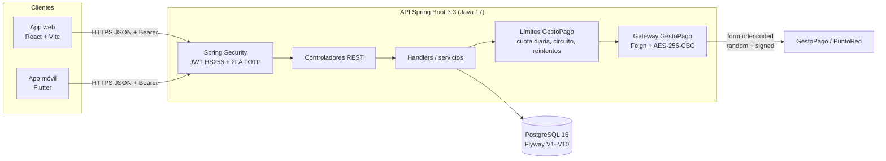
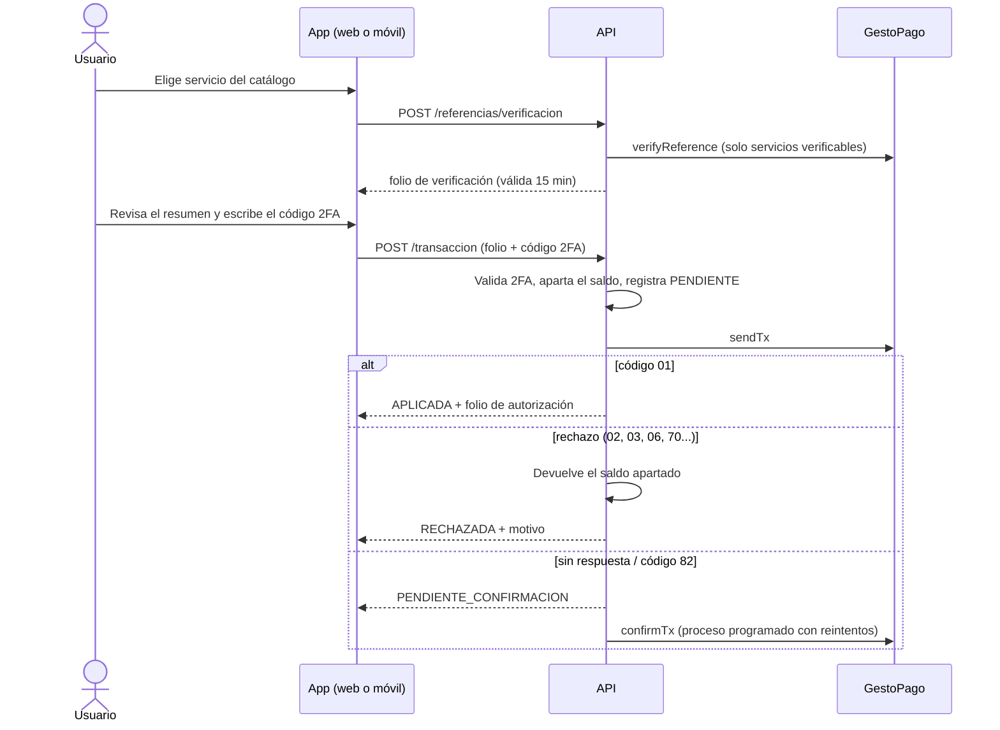

# Plataforma de pagos de servicios GestoPago — Documento técnico

## 1. Objetivo

Plataforma para pagar servicios (luz, agua, telefonía, TV, etc.) y comprar recargas y PINes por medio del
proveedor **GestoPago / PuntoRed**. Se entrega con dos clientes con la misma funcionalidad:

| Cliente | Tecnología | Carpeta |
|---|---|---|
| Aplicación web | React 19 + Vite + TypeScript | `web/` |
| Aplicación móvil | Flutter 3 / Dart (Material Design 3, Android) | `mobile/` |

Ambos consumen **la misma API REST** (Spring Boot, carpeta raíz del repositorio), por lo que comparten usuarios,
credenciales, cuentas e historial. Ninguno de los clientes se comunica directamente con GestoPago: las llaves de
cifrado, el token del distribuidor y las reglas de negocio viven solo en el servidor.

## 2. Arquitectura

### 2.1 Capas del servidor

- **Controladores** (`controller/`): reciben JSON y responden siempre `ApiResponse<T>` `{codigo, mensaje, datos}`
  (`codigo` 0 = éxito, 1 = error). Todas las consultas son `POST` con cuerpo (sin datos sensibles en la URL).
- **Handlers** (`handler/`): un caso de uso por clase (`SendTxHandler`, `VerificarReferenciaHandler`,
  `DepositoHandler`, `ConfirmTxProceso`…).
- **Servicios** (`service/`): catálogo, historial, token de GestoPago, registro de movimientos de saldo.
- **Seguridad** (`seguridad/`): cifrado AES de GestoPago, TOTP (RFC 6238), emisión/validación de JWT,
  bloqueo por intentos fallidos y lista de sesiones revocadas.
- **Persistencia**: JPA + PostgreSQL; el esquema se crea con migraciones Flyway.

### 2.2 Clientes

| Aspecto | Web | Móvil |
|---|---|---|
| Navegación | `react-router-dom` (rutas `/login`, `/registro`, `/catalogo`, `/pagar/...`, `/historial`, `/cuenta`) | `NavigationBar` en teléfono, `NavigationRail` en tableta |
| Sesión | Token en memoria + `sessionStorage` (se borra al cerrar la pestaña) | Token en `flutter_secure_storage` (Android Keystore) |
| Cierre de sesión | Automático al vencer el token o al recibir 401; al salir se revoca en el servidor | Igual |
| URL de la API | `VITE_API_URL` | `--dart-define=API_URL=...` |
| Diseño | CSS responsivo, modo claro/oscuro | Material 3, claro/oscuro |

## 3. Servicios consumidos

### 3.1 API propia (consumida por web y móvil)

| Método y ruta | Autenticación | Uso |
|---|---|---|
| `POST /api/v1/clientes` | Pública | Registro de cliente; crea usuario y cuenta de 16 dígitos con saldo inicial |
| `POST /api/v1/auth/login` | Pública | Usuario o correo + contraseña → `tokenTemporal` y siguiente paso (`CONFIGURAR_A2F` / `VERIFICAR_A2F`) |
| `POST /api/v1/auth/a2f/configuracion` | Token temporal | Devuelve secreto y URI `otpauth://` (se muestra como QR) |
| `POST /api/v1/auth/a2f/verificacion` | Token temporal | Código TOTP → JWT de acceso (30 min), usuario y número de cuenta |
| `POST /api/v1/auth/logout` | JWT | Revoca el token (su `jti`) aunque aún no venza |
| `GET /productosList` | Pública | Catálogo con logotipo, categoría, tipo de operación y tipo de referencia |
| `POST /api/v1/referencias/verificacion` | JWT | Verifica la referencia de un servicio; devuelve un **folio de verificación** |
| `POST /api/v1/transaccion` | JWT + código 2FA | Ejecuta el pago (requiere el folio de verificación en pagos de servicio) |
| `POST /api/v1/transaccion/historial` | JWT | Historial paginado del usuario, con filtro por estatus |
| `POST /api/v1/transaccion/detalle` | JWT | Detalle de una operación propia |
| `POST /api/v1/cuentas/consulta` | JWT | Saldo de la cuenta propia |
| `POST /api/v1/cuentas/deposito` | JWT + código 2FA | Depósito a la cuenta propia (monto máximo configurable) |

La documentación interactiva está en `/swagger-ui.html` cuando la API corre en local.

### 3.2 GestoPago / PuntoRed (consumido solo por el servidor)

| Servicio | Uso en la plataforma | Límite aplicado |
|---|---|---|
| `/sistema/app/jwt-gp/authenticate/` | Token del distribuidor (vigencia 1 día) | Renovación como máximo 1 vez cada 15 min |
| `getProductList` | Catálogo; se guarda en la tabla `productos_catalogo` | Máximo 2 llamadas al día (GestoPago bloquea la IP desde 3) |
| `sendTx` | Envío del pago o recarga | Circuito: 5 fallas seguidas → pausa de 10 min |
| `confirmTx` | Confirma operaciones sin respuesta (código 82 / timeout) | Desde 62 s después; reintentos a 1, 5, 15 y 60 min, máximo 8 → `REVISION_MANUAL` |
| `verifyReference` | Validación de referencias de servicios verificables (`tipoFront 4`) | Máximo 20 verificaciones por usuario por hora |
| Imágenes públicas | Logotipos (`/servicios/{id}.png`) y ayuda de referencia (`/referencias/{id}.jpg`) | — |

Las peticiones `sendTx`, `confirmTx` y `verifyReference` se envían como `application/x-www-form-urlencoded`
con los campos `random` y `signed`, cifrados con AES-256-CBC/PKCS5 según el ejemplo de la documentación de
GestoPago. Las llaves se leen de variables de entorno (`GESTOPAGO_SECRET_KEY`, `GESTOPAGO_IV`).

## 4. Flujo de pago

Reglas clave:

1. **No se puede pagar un servicio sin verificar la referencia**: la API exige el folio de verificación, que
   caduca y solo sirve para el mismo usuario, servicio y referencia. En recargas se valida el teléfono de 10 dígitos.
2. **Confirmación explícita**: el usuario ve servicio, referencia/teléfono, cuenta de cargo e importe, y confirma
   con su código 2FA. Si el código es incorrecto se queda en la confirmación; tras varios intentos se bloquea.
3. **Resultado distinguible**: exitoso (verde, con folio), pendiente (naranja, saldo apartado hasta confirmar) o
   rechazado (rojo, saldo devuelto). Nunca se muestra éxito sin la respuesta `01` de GestoPago.
4. **Historial**: la API filtra por la cuenta del token, por lo que cada usuario solo ve sus operaciones.

## 5. Seguridad

- Contraseñas con BCrypt; política de 8 a 64 caracteres con mayúscula, minúscula, número y símbolo.
- Inicio de sesión en dos pasos con TOTP (Google/Microsoft Authenticator); bloqueo de 15 min tras 5 intentos.
- JWT HS256 de 30 minutos con identificador (`jti`); al cerrar sesión se revoca en la tabla `tokens_revocados`.
- El pago y el depósito vuelven a pedir el código 2FA.
- CORS limitado a los orígenes configurados en `CORS_ORIGENES`.
- Errores sin trazas ni detalles internos (`server.error.include-*=never`).
- Ninguna credencial en el código fuente: todo se lee de variables de entorno o de un `.env` local no versionado
  (ver `.env.example`).

## 6. Base de datos (migraciones Flyway)

| Migración | Contenido |
|---|---|
| V1 | Token de GestoPago |
| V2–V4 | Clientes, domicilios, información laboral, usuarios, reglas e índices |
| V5 | Número de cuenta de 16 dígitos |
| V6 | Inicio de sesión, intentos fallidos y 2FA |
| V7 | Transacciones de GestoPago |
| V8 | Depósitos |
| V9 | Contador de llamadas a GestoPago, catálogo local y reintentos de confirmación |
| V10 | Verificaciones de referencia y tokens revocados |

## 7. Configuración

Variables de entorno principales (valores de ejemplo en `.env.example`):

| Variable | Descripción |
|---|---|
| `DB_URL`, `DB_USERNAME`, `DB_PASSWORD` | Conexión a PostgreSQL |
| `JWT_SECRETO` | Secreto para firmar los JWT (mínimo 32 caracteres) |
| `GESTOPAGO_ID_DISTRIBUIDOR`, `GESTOPAGO_CODIGO_DISPOSITIVO`, `GESTOPAGO_PASSWORD` | Credenciales de prueba del distribuidor |
| `GESTOPAGO_SECRET_KEY`, `GESTOPAGO_IV`, `GESTOPAGO_API_KEY` | Cifrado de peticiones |
| `CORS_ORIGENES` | Orígenes permitidos (p. ej. `http://localhost:5173`) |
| `SALDO_INICIAL_CUENTA`, `DEPOSITO_MONTO_MAXIMO` | Saldo de una cuenta nueva y depósito máximo |

## 8. Pruebas automatizadas

| Proyecto | Comando | Qué cubre |
|---|---|---|
| API | `./gradlew test` | Handlers, cifrado, TOTP, seguridad, límites de GestoPago (WireMock, sin llamar a GestoPago real) |
| Web | `npm --prefix web run build` | Compilación y tipos de TypeScript |
| Móvil | `flutter analyze` y `flutter test` | Cliente HTTP, modelos, pantallas de inicio de sesión |
